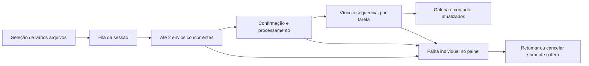

# Plano de feedbacks e anexos

Planejamento iniciado em 16/10/2026 e atualizado após as definições visuais aprovadas em 19/10/2026. O backend descrito em ENDPOINTS.md já disponibiliza o contrato de contagem e progresso; a implementação frontend segue as decisões abaixo.

## 1. Decisões de produto confirmadas

- Os envios continuam ao fechar o card, trocar de tela ou mudar a competência.
- Retomar a fila após recarregar ou reabrir a página fica fora desta entrega.
- A API fornece `attachmentCount` nas tarefas, ocorrências, projeções e mutações.
  A contagem considera somente vínculos ativos confirmados.
- Anexos podem ser selecionados em conjunto e enviados em segundo plano. Um
  arquivo que falhar não desfaz os que foram adicionados.
- Os cards fechados mostram um ícone discreto de clipe com a quantidade de anexos.
- Até existir preview real, todos os anexos usam a representação genérica
  **Documento**, em miniaturas médias lado a lado.

Não há outra dúvida de produto necessária para este planejamento.

## 2. Diagnóstico do funcionamento atual

| Área                                     | Situação encontrada                                                                                                      | Consequência                                                                        |
| ---------------------------------------- | ------------------------------------------------------------------------------------------------------------------------ | ----------------------------------------------------------------------------------- |
| Avisos globais                           | Atualização operacional, erro de transição, cópia de dados e upload possuem emissores próprios no canto inferior direito | Avisos podem se sobrepor; cada um tem duração e camada diferentes                   |
| Fotos e anexos                           | `FileUploadControl` coloca `FileUploadFeedback` dentro dos cabeçalhos                                                    | Progresso, erro e sucesso mudam a altura dos cards e deslocam os controles          |
| Resultado de upload                      | Sucesso e cancelamento continuam visíveis até fechar                                                                     | Um resultado transitório vira parte permanente da tela                              |
| Equipe, vínculos e detalhes de entidades | Mensagens de sucesso e erro entram no fluxo da página e não seguem uma expiração comum                                   | O conteúdo cresce e mensagens antigas permanecem após outras ações                  |
| Formulários                              | `CreationErrorSummary` foca o resumo quando a lista de erros muda                                                        | Corrigir um campo pode retirar o foco da digitação se ainda houver outros erros     |
| Configurações                            | Algumas ações de desenvolvimento produzem avisos persistentes depois do clique                                           | A ação parece disponível, mas termina em um impedimento visual                      |
| Confirmações                             | Há usos de `window.confirm` ao lado de confirmações próprias                                                             | Interação e apresentação variam conforme a tela                                     |
| Envio                                    | Os seletores recebem um arquivo e o hook mantém apenas um pendente                                                       | Não há fila nem seleção múltipla; outro envio fica bloqueado                        |
| Continuidade                             | O hook cancela ao desmontar; o upload global remonta ao mudar a competência                                              | Fechar o card ou trocar de competência pode interromper o trabalho                  |
| Contagem                                 | Quatro mapeamentos atribuem `attachments: 0`; substituir uma tarefa no cache pode sobrescrever os indicadores            | Um contador apenas visual continuaria errado após carregamentos e outras alterações |
| Galeria                                  | A integração atual mostra linhas; o teste anterior possui a faixa horizontal de previews                                 | A apresentação real se afastou do padrão pedido                                     |

Referências principais:

- [App.tsx](src/App.tsx),
  [RoutineControlTable.tsx](src/components/routine-control/spreadsheet/RoutineControlTable.tsx)
  e [TaskAttachmentUpload.tsx](src/components/files/TaskAttachmentUpload.tsx):
  emissores globais independentes.
- [FileUploadControl.tsx](src/components/files/FileUploadControl.tsx),
  [FileUploadFeedback.tsx](src/components/files/FileUploadFeedback.tsx),
  [EmployeesPage.tsx](src/pages/EmployeesPage.tsx),
  [EntityDetailPage.tsx](src/pages/EntityDetailPage.tsx) e
  [ClientRoutineAssignmentsPanel.tsx](src/components/entities/ClientRoutineAssignmentsPanel.tsx):
  mensagens inseridas no layout.
- [CreationFeedback.tsx](src/components/forms/CreationFeedback.tsx): foco do resumo
  dependente das mensagens.
- [useFileUpload.ts](src/hooks/useFileUpload.ts),
  [routineControlService.ts](src/services/routineControlService.ts) e
  [routineControlMappers.ts](src/query/routineControlMappers.ts): ciclo de envio e
  dados de contagem.

## 3. Política única de feedback

| Tipo                                 | Apresentação proposta                                          | Duração e comportamento                                                                       |
| ------------------------------------ | -------------------------------------------------------------- | --------------------------------------------------------------------------------------------- |
| Validação de campo                   | Abaixo do campo, com `aria-invalid` e `aria-describedby`       | Permanece até correção; não gera toast nem move o foco durante a digitação                    |
| Erro geral de formulário             | Área própria do formulário, preservando valores                | Permanece enquanto impedir o envio; foco apenas após uma tentativa inválida de salvar         |
| Sucesso simples                      | Toast global compacto                                          | Cerca de 4 segundos; fechamento opcional                                                      |
| Cópia de dados                       | Mesmo toast global                                             | Sucesso por cerca de 3 segundos                                                               |
| Falha de uma ação fora de formulário | Toast resumido e registro acessível no painel de atividades    | Toast por cerca de 8 segundos; detalhes e nova tentativa continuam disponíveis após ele sumir |
| Atualização automática de dados      | Indicador discreto na área de navegação ou no controle afetado | Sem toast a cada refetch                                                                      |
| Salvamento de um campo               | Indicador curto junto ao controle                              | Salvando/salvo sem alterar a estrutura do card; erro de validação permanece no campo          |
| Envio em segundo plano               | Indicador global de fila e painel recolhível                   | Trabalhos e falhas ficam no painel; resultado do lote gera um único resumo curto              |
| Aviso persistente de contexto        | Banner na seção efetivamente afetada                           | Persiste somente enquanto a condição existir                                                  |
| Falha de carregamento                | Na região que não carregou, com nova tentativa                 | Preserva o restante utilizável da tela                                                        |
| Conclusão de cadastro                | Manter a etapa `CreationSuccess`                               | É uma etapa do fluxo, não um aviso temporário                                                 |

Regras comuns:

- Um único viewport administra os toasts, com limite de dois visíveis,
  deduplicação e agrupamento de resultados repetidos.
- Hover, foco de teclado e aba oculta pausam a contagem de expiração dos toasts.
- Toasts não recebem foco automaticamente e respeitam modais, `inert`, teclado,
  leitores de tela e a ordem das camadas.
- Fechar ou recolher uma mensagem não cancela uma operação. Cancelar é uma ação
  separada, identificada no painel de envios.
- O painel de atividades preserva erros recuperáveis; não é necessário manter um
  aviso grande aberto para oferecer uma nova tentativa.
- Sucessos e progresso deixam de ocupar cabeçalhos de fotos, departamentos e
  anexos. Mensagens longas usam resumo no toast e detalhes no painel.
- Recursos indisponíveis devem ser apresentados como indisponíveis antes da
  interação, em vez de gerar um aviso permanente a cada clique.
- A fase e a intenção da operação são dados próprios, não comparações com textos
  como `"Arquivo salvo."` para decidir ícone e cor.

Textos de resultado: “Anexos adicionados”, “Foto atualizada” e “Imagem do
departamento atualizada”. Para o progresso, “Aguardando”, “Enviando” e
“Verificando” são suficientes na interface; confirmação e vínculo permanecem
etapas internas.

## 4. Fila de anexos em segundo plano

### Organização

Criar um provider de envios estável durante a sessão organizacional, acima dos
cards e das rotas, sem depender da competência selecionada. Menu de contexto,
atalhos das listas e painel da tarefa alimentam a mesma fila. Fotos e imagens
continuam selecionando um arquivo por vez, com feedback no mesmo sistema.

Separar responsabilidades conforme a organização atual do projeto:

- Contextos/providers: estado da fila e notificações.
- Hooks: seleção, consulta da fila e comandos de cancelar/retomar.
- Services: contrato HTTP e envio ao armazenamento.
- Componentes: seletor, indicador, painel de atividades, contador e galeria.
- Query/cache: metadados e contagens autorizadas; nunca URLs assinadas duráveis.

### Funcionamento

- Seletores de anexos usam `multiple`; o menu continua abrindo o seletor no mesmo
  evento de clique, sem abrir o card.
- Cada item captura o `File`, destino, organização, membership, competência,
  identificador e chaves de idempotência antes da primeira requisição. Trocar a
  tela não muda o destino de um envio existente.
- Começar com dois fluxos completos concorrentes, mantendo a vaga até vincular,
  falhar ou cancelar. Arquivos aguardando não criam intenções antecipadas.
- Intenções preservadas após falhas continuam contando como reservas não
  vinculadas. A fila contabiliza também essas reservas antes de iniciar outro
  arquivo; liberá-las exige vínculo, cancelamento confirmado ou expiração
  confirmada. O limite do servidor continua sendo a autoridade, inclusive para
  envios iniciados em outra aba.
- Permitir novos lotes enquanto outros trabalham. Uma falha não bloqueia os
  demais arquivos nem exige reenviar o lote inteiro.
- Vínculos e remoções da mesma tarefa passam pelo mesmo coordenador. Releitura
  de ETag e escrita são serializadas para evitar que dois arquivos usem a mesma
  versão.
- Em `412`, atualizar o destino e deixar o item aguardando uma retomada explícita.
  Recuperações de respostas perdidas reutilizam a chave da operação, sem duplicar
  vínculos ou reenviar bytes aprovados.
- Rejeitado, removido ou expirado exige novo envio. Bytes interrompidos nunca são
  confirmados como se o envio tivesse terminado.
- Polling usa espera progressiva e respeita `Retry-After`. O limite de requisições
  deve considerar o conjunto dos envios, evitando um timer agressivo por arquivo.
- Respeitar os limites documentados: 20 anexos ativos por tarefa, configurável;
  10 uploads não vinculados por membro; 20 MiB por anexo; throttle padrão de
  120 solicitações por minuto. Limites atingidos pausam o trabalho afetado sem
  produzir uma sequência de avisos iguais.
- O envio usa `XMLHttpRequest.upload.progress` com percentual real de transporte
  (`loaded / total` somente quando calculável). O POST multipart não recebe cookies
  nem headers da API. Depois do envio, a barra fica indeterminada durante a
  verificação e o vínculo; 100% dos bytes não significa conclusão.
  `uploadExpiresAt` limita somente o envio ao armazenamento; `expiresAt` controla
  a intenção não vinculada.
- Trocar de organização ou sair da conta interrompe os trabalhos do contexto
  anterior antes de iniciar requisições com a nova sessão.
- Recarregar ou fechar a página interrompe a fila que depende do navegador.
  Processamento já confirmado no backend tem ciclo próprio; persistência e
  retomada da fila não fazem parte do escopo confirmado.

### Atualização de dados

Atualizar a coleção e a contagem do destino após cada vínculo confirmado. Agrupar
as releituras operacionais por destino/lote, em vez de invalidar todas as telas
repetidamente para cada arquivo. Não incrementar o contador quando o arquivo
apenas entra na fila ou termina de chegar ao armazenamento.

## 5. Quantidade de anexos e contrato do backend

Campo disponível no contrato de 19/10/2026: `attachmentCount`, inteiro não negativo, com quantidade de
vínculos ativos. Intenções e arquivos não vinculados não entram na contagem.
Ocorrências virtuais retornam zero sem materialização.

O campo deve estar presente nos serializers de tarefas e ocorrências usados em:

- Listagens e detalhes.
- Projeções de planilha e agenda.
- Respostas das alterações de tarefa, para que mudar status ou responsável não
  zere o contador.
- Recibos de vínculo de anexo, para atualizar a quantidade após confirmação.

Manter o `DELETE` de anexo com `204`; após remoção confirmada, atualizar a contagem
conhecida e reconciliar com uma leitura agrupada. O backend deve calcular os
totais de modo agregado, evitando uma consulta por tarefa.

No frontend:

- Corrigir os quatro pontos que hoje atribuem `attachments: 0` e preservar a
  informação ao substituir tarefas no cache.
- Usar um indicador compartilhado em planilha, listas, agenda e cards da Home.
- Exibir clipe e quantidade somente quando o valor for positivo; não mostrar
  zero enquanto a contagem for desconhecida durante uma migração de contrato.
- O contador é uma informação de leitura, independente da permissão de adicionar
  anexos. Um viewer também deve vê-lo.
- Preservar o tamanho do card fechado, o ícone de status, o clique e o menu de
  contexto. Envios pendentes pertencem ao indicador da fila, não ao contador de
  anexos confirmados.

O contrato atual permite consultar `count` na coleção de anexos, mas fazer isso
para cada card cria muitas requisições. Como foi aprovada a contagem na API, essa
consulta por card não será a estratégia principal.

O contrato operacional desta implementação é a revisão de 19/10/2026 de [ENDPOINTS.md](ENDPOINTS.md). Os documentos complementares referenciados pelo backend não estão neste repositório; os campos necessários para transporte, polling, contagem e concorrência estão descritos no próprio ENDPOINTS.md.

## 6. Galeria de documentos

Usar como referência o layout `single-row` de
[RoutineCardActions.test.tsx](src/components/routine-control/shared/RoutineCardActions.test.tsx)
e [RoutineDetailsCard.test.tsx](src/components/routine-control/details/RoutineDetailsCard.test.tsx).

- Faixa horizontal com uma única linha e altura previsível, com rolagem horizontal
  quando necessário, sem aumentar a altura conforme a quantidade.
- Miniaturas médias de 160 px de largura e 176 px de altura, mantendo a faixa
  dentro dos 208 px usados pelo teste anterior. Conferir essa composição em
  desktop e mobile.
- Todas usam o desenho genérico de uma folha e o rótulo “Documento”. Nome,
  extensão e tamanho vêm dos metadados reais.
- Nome limitado a duas linhas em uma área fixa, com acesso ao texto completo;
  download e remoção acessíveis por teclado e conforme as permissões atuais.
- Ações e carregamentos não alteram a dimensão da miniatura. Os arquivos
  selecionados aparecem também na galeria do destino, com estado de fila, barra
  fina durante o envio, verificação indeterminada ou falha com acesso aos envios.
  Esses itens não incrementam a contagem até o vínculo confirmado. A barra ocupa
  espaço reservado abaixo da prévia e mantém o documento visível.
- Sem arquivos, manter somente a área compacta de adicionar, quando permitida.
  A primeira expansão da galeria decorre do conteúdo adicionado, não de um aviso.
- Não representar conteúdo real de PDF, planilha, XML ou imagem enquanto não
  existir preview. Os exemplos ilustrativos antigos têm conteúdo fictício e
  incluem formatos que a API não aceita; não devem ser usados como conteúdo dos
  arquivos enviados.
- Não criar anexos fictícios para completar uma contagem. Identificadores e
  miniaturas correspondem a recursos reais da coleção.

O escopo mantém os formatos atuais da API: PDF, TXT, CSV, JPEG, PNG e WebP. A
galeria não amplia essa lista por causa dos formatos usados em testes antigos.

## 7. Ordem de implementação

1. **Base de feedback:** provider/viewport único, política de duração e painel de
   atividades; tirar progresso e sucessos dos cabeçalhos; unificar avisos do App,
   cópia, equipe, vínculos e detalhes de entidades.
2. **Fila de envios:** seleção múltipla, execução fora dos cards, concorrência
   limitada, destinos capturados e coordenação de ETags/remoções; conectar menu e
   detalhes à mesma fila.
3. **Contrato e contadores:** implementar `attachmentCount` no backend e schema;
   integrar mapeamentos/cache e indicador compartilhado em todos os cards.
4. **Galeria horizontal:** substituir as linhas atuais por miniaturas Documento,
   mantendo as ações reais e o layout de referência.
5. **Revisão transversal:** foco de validação, mensagens de formulários, avisos de
   configuração e confirmações; conferência final de responsividade e temas.

A definição do contrato de contagem deve começar em paralelo à primeira etapa.
Não é necessário um endpoint de upload em lote: a fila pode orquestrar os
endpoints individuais já documentados.

## 8. Critérios de aceite

- Sucesso, erro transitório ou progresso não muda a altura de um card/cabeçalho.
- Avisos simultâneos não se cobrem; recolher um aviso não cancela o envio.
- Expiração, pausa por foco/hover e anúncios acessíveis são consistentes.
- Corrigir erros de um formulário não retira o foco da digitação.
- Selecionar vários arquivos cria um lote; o restante do site continua utilizável.
- Fechar detalhes e navegar entre telas/competências não interrompe a fila.
- Lotes destinados a tarefas diferentes preservam seus destinos e permissões.
- Vínculos da mesma tarefa não competem pela mesma versão; falha parcial permite
  repetir somente os itens afetados.
- Resposta perdida, rejeição, expiração, cancelamento, `412`, `429` e
  indisponibilidade não geram duplicação nem falsas confirmações.
- O contador permanece correto após refetch, mudança de status/responsável,
  navegação e remoção; fica visível também para leitores.
- Miniaturas Documento ficam lado a lado, com dimensões estáveis, inclusive com
  nomes longos, no teclado e nos três temas.
- Validar os cenários em 390 px e desktop, além dos testes de fila, contrato,
  cache, integração de menu, foco e política de notificações.

Esta etapa é uma análise de código e planejamento. A implementação deve validar
o contrato atualizado e executar os testes e a conferência visual sobre as
mudanças efetivamente realizadas.

## 9. Implementação e revisão

- A sessão organizacional mantém uma fila global de anexos, fotos e imagens, acima das telas e independente da competência. Seleção múltipla e menu de contexto alimentam essa mesma fila; o menu abre o seletor sem abrir o card.
- Dois fluxos completos trabalham ao mesmo tempo. As solicitações da fila são espaçadas, `Retry-After` pausa novas permissões de API e o polling também propaga bloqueios de throttle. Vínculos e remoções do mesmo destino usam uma coordenação única de ETags.
- Cancelamento é diferente de recolher o painel. Uma resposta perdida ao criar a intenção é recuperada com a mesma chave antes de liberar a reserva. Falha ao cancelar mantém essa ação recuperável, sem reiniciar bytes por engano. Troca de organização ou saída aborta a fila anterior sem limpeza com cookies da nova sessão.
- A barra de envio é real e fica abaixo do desenho Documento. Fila, preparação, envio, verificação, conclusão e falha usam estados próprios. A confirmação visual de conclusão depende do vínculo, e respostas antigas de idempotência não substituem a contagem atual.
- Cada vínculo reconcilia a coleção e os metadados do destino, incluindo ETag e materialização, sem esperar outros arquivos do lote. A leitura operacional mais ampla é agrupada por resultado do lote.
- Uma faixa horizontal reúne miniaturas de 160 × 176 px, com nome em até duas linhas e ações conforme permissões. Previews de conteúdo fictício e arquivos inventados a partir da contagem foram retirados.
- O acesso Envios fica na barra superior e no contexto dos anexos. O painel lateral usa portal, foco e teclado próprios; Escape recolhe somente o painel quando há uma tarefa aberta. No celular, os acessos ficam compactos e a competência permanece centralizada e legível.
- Toasts usam superfícies dos temas, acentos semânticos discretos, limite de dois, agrupamento, duração e pausas. Falhas continuam disponíveis no histórico Avisos. Abrir Envios pausa e oculta seus próprios toasts para evitar duplicação.
- Avisos de cópia, equipe, entidades, vínculos e configurações usam a mesma base. Atualizações automáticas têm indicador discreto. Validação fica no formulário, com bordas consistentes e foco do resumo somente após submissão inválida; observações preservam uma região de status com altura fixa.
- Os avisos de convites e atualização da área administrativa também usam essa base, com acesso ao histórico no cabeçalho interno. O Prettier preserva as quebras de linha locais (`endOfLine: auto`), mantendo a checagem compatível com Windows e CI sem alterações de conteúdo em arquivos não relacionados.
- A revisão inclui testes de transporte, fila, continuidade, escopo, idempotência, contagens, remoção, acessibilidade e avisos, além de conferência no navegador em Claro, Escuro e Jaral. As larguras verificadas incluem 320, 360, 390, 479, 640 e 1280 px, sem colisões entre os controles e a competência ou rolagem horizontal da página.

Os testes de API usam respostas controladas do contrato. A integração com um servidor autenticado e o CORS do armazenamento devem ser conferidos no ambiente de execução; a fila continua durante navegação interna, sem persistência após recarregar ou fechar a página.
