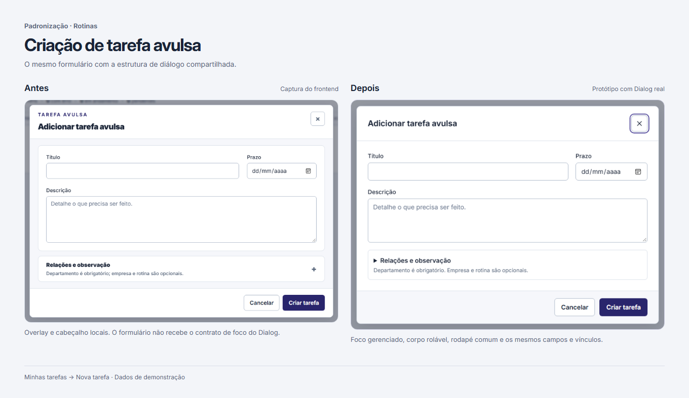
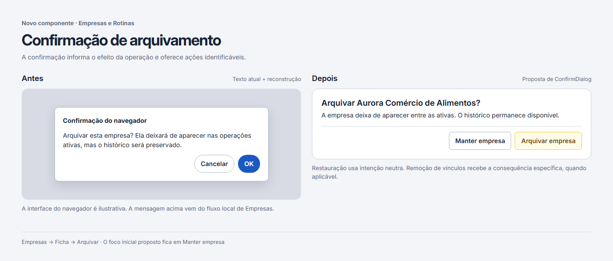
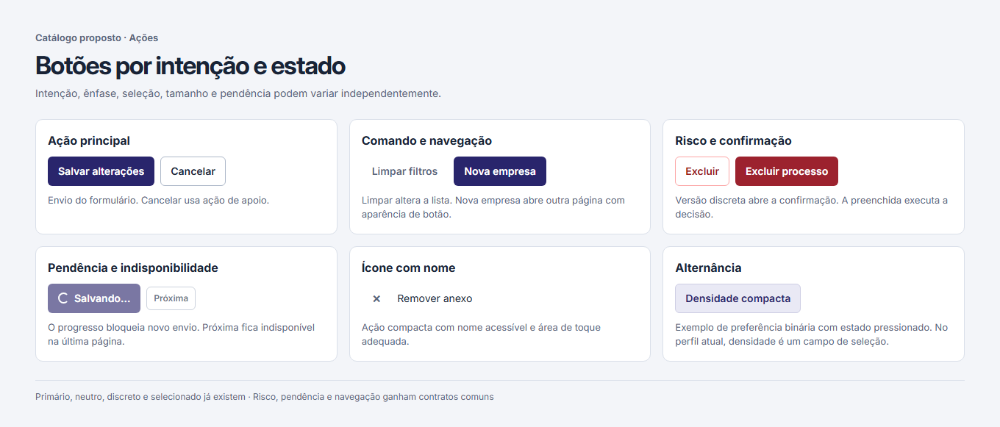

# Plano de padronização de componentes do frontend

Auditoria de 25/11/2026 do checkout `staging` na revisão `68d34a2`, incluindo as alterações locais já presentes. O recorte cobre Rotinas, Processos, Honorários, Empresas, Equipe, HUB, autenticação, configurações e administração interna. As propostas seguem [os padrões visuais do projeto](../../padroes-interface.md).

1. [Itens avulsos](#caso-1--itens-avulsos) usam um componente existente.
2. [Itens recorrentes ou estruturais](#caso-2--itens-recorrentes-ou-estruturais) ganham um componente compartilhado.
3. [Novos tipos e variantes](#caso-3--novos-tipos-e-variantes) ampliam o catálogo, com piloto definido ou adoção condicionada.

## Caso 1 · Itens avulsos

Cada ocorrência adota um componente que já existe no frontend. A lógica do fluxo continua no respectivo consumidor.

| Ocorrência atual                                                                                              | Componente a usar                                                                                                                                                                                                                                                                           | Como aplicar                                                                                                                                                                                                        |
| ------------------------------------------------------------------------------------------------------------- | ------------------------------------------------------------------------------------------------------------------------------------------------------------------------------------------------------------------------------------------------------------------------------------------- | ------------------------------------------------------------------------------------------------------------------------------------------------------------------------------------------------------------------- |
| **Minhas tarefas → Nova tarefa** (`LooseTaskFormModal`)                                                       | [`Dialog`](../../../src/components/ui/Dialog.tsx) + [`Button`](../../../src/components/ui/Button.tsx)                                                                                                                                                                                       | Usar título, corpo rolável e rodapé do diálogo. Manter campos e vínculos, com uma guarda de envio para todos os caminhos de fechamento.                                                                             |
| **Rotinas → Detalhes de tarefa** (`TaskDetailsDialog`) e **Processos → Novo/Editar processo** (`ProcessForm`) | [`Dialog`](../../../src/components/ui/Dialog.tsx)                                                                                                                                                                                                                                           | Migrar cada moldura após validar empilhamento em Rotinas e fechamento durante a abertura ou recuperação em Processos. Preservar a ficha operacional e o CSS de domínio.                                             |
| **Nova tarefa**, ações convencionais de **Processos** e fechamentos locais de **Telas**                       | [`Button`](../../../src/components/ui/Button.tsx) e [`IconButton`](../../../src/components/ui/IconButton.tsx)                                                                                                                                                                               | Usar `Button` para comandos com texto e `IconButton` para fechar, atualizar ou remover com nome acessível.                                                                                                          |
| **Campos de abertura e edição de Processo** e seletores locais de cadastros                                   | [`TextField`](../../../src/components/ui/TextField.tsx), [`Textarea`](../../../src/components/ui/Textarea.tsx), [`Select`](../../../src/components/ui/Select.tsx) e [`Combobox`](../../../src/components/ui/Combobox.tsx)                                                                   | Substituir entradas locais equivalentes e manter validação e máscaras. Usar `Combobox` para escolha única pesquisável quando houver opções estruturadas. A seleção de empresa em Honorários já serve de referência. |
| **Criar empresa em Rotinas** e rodapés simples de **cadastro/edição**                                         | [`CreationProgress`](../../../src/components/forms/CreationProgress.tsx), [`FormSection`](../../../src/components/forms/FormSection.tsx) e [`FormActions`](../../../src/components/forms/FormActions.tsx)                                                                                   | Adotar a estrutura existente onde revisão, retorno de etapa e ações de cancelar e submeter sejam equivalentes.                                                                                                      |
| **Cabeçalhos operacionais**, retorno aos módulos e acesso ao perfil                                           | [`WorkspaceBar`](../../../src/layouts/WorkspaceBar.tsx), [`ModulesReturnLink`](../../../src/components/common/ModulesReturnLink.tsx), [`SidebarProfileLink`](../../../src/components/common/SidebarProfileLink.tsx) e [`NavigationIcon`](../../../src/components/common/NavigationIcon.tsx) | Adotar a barra existente onde título e ações têm a mesma anatomia. Nas entradas globais equivalentes, preservar destino, estado ativo e composição de ícones.                                                       |
| **Marcadores de categoria e metadados**                                                                       | [`Badge`](../../../src/components/ui/Badge.tsx)                                                                                                                                                                                                                                             | Reutilizar as variantes neutra ou de marca para informação passiva. A situação operacional usa `StatusBadge` no Caso 2.                                                                                             |

[01 · Tarefa avulsa com Dialog](imagens/01-dialogo-tarefa.png) · [11 · Formulário de Processos com Dialog](imagens/11-dialogos-processos.png)

## Caso 2 · Itens recorrentes ou estruturais

Cada linha nomeia o componente compartilhado a criar e os fluxos que justificam a adoção. `Field`, `Pagination` e `CurrencyField` já têm versões locais em Honorários. O plano extrai seus contratos para uso transversal com os adaptadores de cada domínio.

| Componente a criar                                                                           | Ocorrências que passam a usá-lo                                                                                                                                                                                                                                        |
| -------------------------------------------------------------------------------------------- | ---------------------------------------------------------------------------------------------------------------------------------------------------------------------------------------------------------------------------------------------------------------------- |
| **`Drawer`**                                                                                 | Editores de empresa, rotina e tela em Rotinas, convite e perfil/acessos da Equipe, Envios e Histórico de notificações. Pilotos no convite e no editor de empresa. Compartilhar foco, fechamento, corpo rolável e rodapé.                                               |
| **`NavigationDrawer`**                                                                       | Menus móveis de Rotinas, Processos, Honorários, Empresas e Equipe. Compartilhar inércia do fundo e restauração de foco. Cada módulo conserva links, grupos e submenus.                                                                                                 |
| **`ConfirmDialog`**                                                                          | Arquivar/restaurar empresa e rotina, remover vínculo de rotina, desativar acesso e descartar rascunho em navegação interna. Usar consequência, ação segura e verbo específico. A guarda nativa atende ao fechamento ou recarregamento da aba.                          |
| **`InlineConfirmation`**                                                                     | Cancelar/excluir processo e reabrir tarefa, reajustar ou alterar situação em Honorários, encerrar vínculo e trocar a tela no cadastro de empresa. Manter os dados necessários para decidir na mesma região.                                                            |
| **`ButtonLink`** e **`ActionGroup`**                                                         | `ButtonLink` em ações que navegam, como adicionar empresa e convidar pessoa. `ActionGroup` em grupos de página ou rodapés com comandos além de cancelar e submeter.                                                                                                    |
| **`ActionMenu`** e **`ActionTrigger`**                                                       | `ActionMenu` usa `FloatingMenu` para menus de registro, lista de Rotinas e Departamentos. `ActionTrigger` reúne ícone, contador e texto para abrir Envios, Avisos e outras superfícies equivalentes.                                                                   |
| **`Field`**, **`CurrencyField`** e **`PasswordField`**                                       | `Field` reúne rótulo, ajuda, erro e adornos em Empresas, Telas, Processos e administração. `CurrencyField` compartilha a apresentação monetária com conversão por domínio. `PasswordField` reúne visibilidade e preenchimento automático em login e aceite de convite. |
| **`SearchField`** e **`SelectionList`**                                                      | `SearchField` evolui `CatalogSearchField` para Catálogos, Diretórios e Processos. `SelectionList` reúne busca, marcação e contagem em criar/editar tela, com ordenação onde a posição importa.                                                                         |
| **`RadioGroup`**, **`CheckboxField`**, **`SwitchField`** e **`FilterChip`**                  | Tipos de processo com escolha única, acessos e destinatários com escolhas acumuláveis, configurações liga/desliga e filtros ativos removíveis. Cada controle expõe seu estado e sua ação.                                                                              |
| **`Tabs`**, **`Disclosure`** e **`Popover`**                                                 | `Tabs` em Arquivados, Perfil/Acessos e Parâmetros. `Disclosure` em seções como Mais filtros quando a expansão precisar de um contrato comum. `Popover` para conteúdo interativo ancorado, com piloto no seletor de destinatários de Processos.                         |
| **`CollectionState`**, **`InlineFeedback`**, **`Skeleton`** e **`Spinner`**                  | `CollectionState` para vazio, busca sem resultado, carregamento e falha em listas. `InlineFeedback` para aviso e atualização local, como recálculo em Honorários. `Skeleton` e `Spinner` convergem indicadores em Honorários, Telas e anexos.                          |
| **`DataTable`** e **`Pagination`**                                                           | Consulta tabular nos Diretórios, Clientes e Orçamentos. Paginação também em Processos, com modos completo e compacto. Preservar a planilha operacional, tamanhos de página e contratos de URL e API.                                                                   |
| **`StatusBadge`**                                                                            | Situações de Processos, Empresas, Honorários e administração. Cada domínio fornece rótulo e tom. A mudança de situação em Rotinas continua sendo um controle interativo.                                                                                               |
| **`PageHeader`**, **`Breadcrumbs`**, **`PanelHeader`**, **`Metric`** e **`DescriptionList`** | `PageHeader` e `Breadcrumbs` convergem cabeçalhos e trilhas de Configurações, administração e Processos. `PanelHeader` e `Metric` padronizam títulos com ações e indicadores. `DescriptionList` reúne pares de rótulo e valor nas fichas.                              |
| **`PeriodNavigator`**                                                                        | Competência de Rotinas e mês de Movimentações, com apresentações de leitura e edição. Cada módulo mantém o escopo do período.                                                                                                                                          |
| **`AuthShell`** e **`BrandMark`**                                                            | Login, aceite de convite e seleção de organização compartilham a moldura e a representação da marca. Cada fluxo conserva mensagens, estados e regras de acesso.                                                                                                        |
| **`FilePicker`** e **`ProgressBar`**                                                         | Seleção e progresso de arquivos em anexos, mídia e importações onde o contrato coincide. Preservar processamento, fila, permissões, cancelamento e recuperação próprios.                                                                                               |

[02 · Drawer](imagens/02-painel-lateral.png) · [03 · ConfirmDialog](imagens/03-confirmacao-arquivar.png) · [04 · InlineConfirmation](imagens/04-acoes-processo.png) · [05 · SearchField e Field](imagens/05-campo-e-busca.png) · [06 · CollectionState e Pagination](imagens/06-estados-e-paginacao.png) · [07 · SelectionList e Tabs](imagens/07-selecao-e-abas.png) · [09 · ActionMenu, StatusBadge e InlineFeedback](imagens/09-novos-em-contexto.png)

## Caso 3 · Novos tipos e variantes

O catálogo inclui componentes novos, como `DocumentDialog` e `ToggleButton`, e variações que entram nas bases `Button` e `IconButton`.

### Com aplicação identificada

| Novo tipo ou variante                                       | Onde experimentar primeiro                                                                                                                                                                                        |
| ----------------------------------------------------------- | ----------------------------------------------------------------------------------------------------------------------------------------------------------------------------------------------------------------- |
| **`DocumentDialog`**                                        | Relatório de Movimentações. Compor sobre `Dialog` com capa, corpo rolável e rodapé com **Baixar PDF**. Preservar conteúdo, exportação e identidade do documento.                                                  |
| **`ToggleButton`**                                          | Estudo da opção **Densidade compacta** no Perfil. Representar o estado binário com `aria-pressed`, preservando Compacta e Confortável.                                                                            |
| **`Button` com intenção destrutiva discreta ou preenchida** | Usar baixa ênfase em **Excluir**, que abre a confirmação, e ênfase preenchida em **Excluir processo**, que executa a ação. Validar a apresentação de atenção para cancelamento reversível conforme a recorrência. |
| **`Button` com estado `pending`**                           | Salvar, enviar convite e confirmar operações. Manter o tamanho, anunciar o progresso e impedir envio duplicado. A saída do formulário segue sua própria guarda.                                                   |
| **`IconButton` denso, padrão e confortável**                | Ações em célula, fechamento de diálogo e controles de toque. Manter nome contextual, foco visível e área acionável compatível com o contexto.                                                                     |

### Com adoção condicionada

| Novo tipo                          | Critério de adoção                                                                                               |
| ---------------------------------- | ---------------------------------------------------------------------------------------------------------------- |
| **`SplitButton`**                  | Uma operação como exportar tem formato padrão comprovado e alternativas recorrentes.                             |
| **`BulkActionBar`**                | Uma coleção oferece ação em lote e define seleção entre páginas, permissões e falha parcial.                     |
| **`SegmentedControl`**             | Duas ou mais visões da mesma coleção compartilham filtros e contexto, como Lista e Quadro.                       |
| **`Accordion`**                    | As seções precisam de abertura exclusiva, persistência ou navegação coordenada.                                  |
| **`MultiSelect`** com busca remota | Uma segunda coleção tem necessidades comparáveis às de destinatários e define o escopo da seleção entre páginas. |
| **`DatePicker`**                   | Regras de disponibilidade ou escolha de intervalo justificam calendário próprio.                                 |
| **`EditableDataGrid`**             | Outra grade exige a navegação por teclado, edição em célula e densidade da planilha operacional de Rotinas.      |
| **`EntityAvatar`**                 | Listagens precisam de identidade visual de empresa e há apresentação definida para ausência de imagem.           |
| **`Dropzone`**                     | Um fluxo justifica arrastar arquivos e oferece também seleção por teclado.                                       |

[08 · Button, IconButton e ToggleButton](imagens/08-catalogo-botoes.png) · [10 · SplitButton, BulkActionBar e SegmentedControl](imagens/10-alternativas-futuras.png) · [11 · DocumentDialog em Movimentações](imagens/11-dialogos-processos.png)

## Prioridade de implementação e aceite

1. **P0 · Interação.** Começar por `Dialog` na tarefa avulsa, empilhamento e guarda de rascunho, `Field`, carregamento dentro de painel, teclado de `Tabs` e pendência de `Button`. Validar Tab, Shift+Tab, Escape, Enter, retorno de foco, carregamento, erro e bloqueio de envio duplicado.
2. **P1 · Adoção compartilhada.** Pilotar `Drawer`, `ConfirmDialog`, `InlineConfirmation`, `SearchField`, `SelectionList` e `Pagination` nos fluxos indicados. Preservar URL, filtros, permissões, máscaras e recuperação de Processos após uma resposta incerta. Verificar tema claro e escuro, celular estreito e notebook.
3. **P2 · Catálogo condicionado.** Adotar os tipos da segunda tabela do Caso 3 conforme seus critérios de entrada. Retirar wrappers e CSS locais após validar os consumidores migrados.

## Inventários e pranchas

- [Diálogos, painéis e confirmações](dialogos.md) detalha molduras atuais, menu móvel, descarte, pilha de foco e confirmações por fluxo.
- [Botões e ações](botoes-e-acoes.md) mapeia 364 declarações em 91 arquivos, com ocorrências e critérios por interação.
- [Padrões transversais](padroes-transversais.md) cobre campos, seleção, tabelas, estados, anexos, navegação, autenticação e indicadores.

As 11 pranchas usam dados sintéticos e identificam capturas do frontend, reconstituições e propostas. A prancha 01 renderiza os componentes atuais do repositório no estudo de `Dialog`. Os demais estudos ilustram os contratos propostos em contexto.

Para reproduzir, execute `npm run preview:features` e, em outro terminal, `node previews/revisao-ux/componentes/capturar.mjs`. O capturador usa o Edge local por padrão e aceita um navegador Chromium por `UX_BROWSER_PATH`. Ele usa uma sessão isolada, verifica o foco e o Escape no protótipo de `Dialog` e atualiza os PNGs desta pasta.
