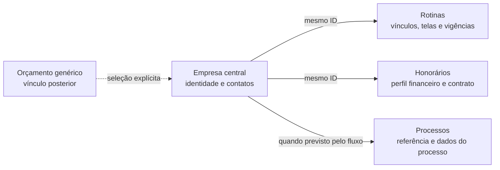

# Empresas compartilhadas entre módulos

Pesquisa e decisão de interface — 15/11/2026. Somente avaliação e prévias; nenhuma alteração de dados ou contratos de produção.

## Conclusão

**Apresentação confirmada na revisão 6:** o catálogo geral abre a página completa da empresa. Rotinas e Honorários abrem janelas para os dados específicos, com link para essa página central.

A organização escolhida é **uma empresa central com dados e operações específicos em cada módulo**. A ficha central reúne a identidade e oferece resumo e acesso aos módulos autorizados. A equipe continua trabalhando nas telas de Rotinas e Honorários, sem manter cópias independentes de nome, código e CNPJ.

O usuário acrescentou duas condições: Clientes de Honorários deve apresentar todas as empresas, inclusive as que ainda não têm dados financeiros; cadastrar a partir de Rotinas ou Honorários precisa criar ou selecionar a empresa central e estabelecer o vínculo obrigatoriamente. Empresa existente é reutilizada. Empresa nova é cadastrada explicitamente antes de receber os dados do módulo.

## O que os produtos pesquisados fazem

| Produto                                     | Organização documentada                                                                                                                  | Aplicação ao Jaralcon                                                                                                 |
| ------------------------------------------- | ---------------------------------------------------------------------------------------------------------------------------------------- | --------------------------------------------------------------------------------------------------------------------- |
| Microsoft Dynamics 365 Finance & Operations | Cadastro compartilhado de pessoas/organizações, com papéis diferentes e dados comuns mantidos centralmente.                              | Separar identidade da empresa e contexto operacional evita que uma alteração cadastral precise ser repetida por área. |
| SAP                                         | Business Partner com dados centrais e atributos próprios dos papéis. Uma organização pode participar de vários contextos.                | Uma empresa pode ter configuração de Rotinas e perfil de Honorários sem virar duas empresas.                          |
| Odoo                                        | Ficha de contato compartilhada, abas vinculadas aos aplicativos e acessos a registros relacionados em outros módulos.                    | A ficha central pode mostrar relações e oferecer acesso às áreas, mantendo o trabalho especializado nos módulos.      |
| Microsoft Business Central                  | Registros de contatos, clientes e fornecedores relacionados, com sincronização dos campos comuns e resolução de conflitos na vinculação. | Cópias sincronizadas são uma alternativa real, mas exigem definir sincronização e precedência dos dados.              |

Fontes primárias: [Microsoft: cadastro compartilhado e papéis](https://learn.microsoft.com/en-us/dynamics365/fin-ops-core/dev-itpro/organization-administration/overview-global-address-book), [SAP: dados centrais e papéis](https://learning.sap.com/courses/basics-of-customizing-for-financial-accounting-gl-ap-ar-in-sap-s-4hana/managing-business-partners), [Odoo: contatos, abas e registros relacionados](https://www.odoo.com/documentation/19.0/applications/essentials/contacts.html), [Business Central: criação, vínculo e sincronização](https://learn.microsoft.com/en-us/dynamics365/business-central/marketing-create-contact-companies).

A recomendação para o Jaralcon é uma inferência a partir desses exemplos e do código local. Os produtos não impõem um único desenho de interface e suas estruturas completas seriam excessivas para este escritório.

## Alternativas consideradas

| Alternativa                                                   | Benefício                                                                                 | Custo ou problema                                                                                                         | Avaliação                                                                        |
| ------------------------------------------------------------- | ----------------------------------------------------------------------------------------- | ------------------------------------------------------------------------------------------------------------------------- | -------------------------------------------------------------------------------- |
| Todos os formulários dentro de Empresas, separados por abas   | Um ponto de entrada para consulta e edição.                                               | Pode obrigar a equipe a sair da tarefa operacional e concentrar permissões e formulários muito diferentes na mesma ficha. | Viável como alternativa, mas não escolhida.                                      |
| Empresa central + telas especializadas + resumo central       | Preserva o contexto dos módulos, compartilha a identidade e permite consulta transversal. | Requer distinguir edição cadastral de configuração do módulo e preservar o retorno à origem.                              | Escolhida.                                                                       |
| Cadastros separados com campos comuns sincronizados           | Pode acomodar módulos ou sistemas independentes.                                          | Introduz conflitos, atrasos e regras de precedência. O usuário pode não saber qual cópia está atualizada.                 | Viável em integrações independentes; não se justifica como escolha inicial aqui. |
| Cada módulo mantém empresa independente e um vínculo opcional | Facilita criar módulos isoladamente.                                                      | Permite duplicação e divergência. Contraria o vínculo obrigatório solicitado.                                             | Descartada para este caso.                                                       |

Arquitetura de dados e navegação são decisões diferentes: duas listas na interface podem consultar a mesma empresa. Ter uma lista de empresas em Rotinas e outra em Honorários não exige duas fontes cadastrais.

## Responsabilidade de cada informação

| Informação                                                                                           | Local responsável                         | Como aparece nos demais módulos                                                                                                            |
| ---------------------------------------------------------------------------------------------------- | ----------------------------------------- | ------------------------------------------------------------------------------------------------------------------------------------------ |
| Nome fantasia, razão social, código, CNPJ, e-mail e telefone cadastrais                              | Empresa central.                          | Consulta da mesma empresa, sujeita à permissão; edição cadastral identificada como compartilhada.                                          |
| Regime tributário cadastral atual                                                                    | Empresa central, conforme contrato atual. | Pode servir de referência inicial. Não deve sobrescrever silenciosamente um cenário de orçamento.                                          |
| Rotinas aplicáveis, vigência, telas e configuração operacional                                       | Rotinas.                                  | Resumo e acesso a Rotinas na ficha central; contagens precisam refletir vínculos, não somente tarefas de um mês.                           |
| Perfil usado na precificação, honorário atual, reajuste, contato comercial e observações financeiras | Honorários.                               | Visíveis apenas com acesso financeiro adequado. Valores não cadastrados aparecem como ausência de dados.                                   |
| Dados de um orçamento e sua proposta salva                                                           | Registro e snapshot do orçamento.         | Preservados como foram emitidos; alterar o cadastro atual não reescreve a proposta antiga.                                                 |
| Etapas, tarefas, responsável, valores e histórico de um processo                                     | Processos.                                | Relacionados à empresa quando o contrato e o fluxo permitirem. Um processo pode conter informações históricas distintas do cadastro atual. |

Código que sustenta a separação: `companyService` possui identidade e vínculos de rotina; `HonorariosClientInput` exige `companyId`; `HonorariosQuoteInput` permite orçamento sem empresa; `HonorariosQuoteSnapshot` preserva os dados emitidos; `ProcessSummaryDto` distingue `empresa`, `companyId` e `companyReference`.

## Fluxos demonstrados

1. **Empresa existente → dados do módulo.** Buscar por nome, código ou CNPJ; selecionar; preencher somente a configuração necessária. Os campos cadastrais não viram uma segunda ficha independente.
2. **Empresa nova a partir do módulo.** Preencher o cadastro central identificado como tal; continuar para a configuração específica; confirmar a criação e o vínculo. A interface deve deixar claro o que já foi salvo se a segunda operação falhar.
3. **Empresa sem dados financeiros.** Aparece na aba Clientes com “Sem dados”. Abrir oferece cadastrar o perfil. Não exibir honorário R$ 0,00, diferença ou classificação comercial inventados.
4. **Empresa já configurada.** Abre a ficha financeira existente ou a configuração de Rotinas. A ação deixa de parecer um novo cadastro da mesma organização.
5. **Ficha central → módulo.** Exibir relação e acesso autorizado, preservando empresa selecionada e retorno. Não conceder acesso financeiro em função de acesso ao cadastro geral.

Orçamentos genéricos continuam permitidos. A orientação de vínculo obrigatório aplica-se ao cadastro da empresa/configuração do módulo; não torna obrigatório cadastrar uma empresa para simular um orçamento.

## Estados que precisam continuar distintos

- Empresa arquivada no cadastro central, perfil financeiro arquivado e empresa inativa no cenário de precificação são situações diferentes.
- Empresa sem perfil não equivale a cliente de honorário zero, proposta recusada ou configuração inválida.
- Permissão para consultar uma referência de empresa em um módulo não equivale a permissão para editar seu cadastro completo.
- Ações financeiras e snapshots preservam seus próprios controles de versão. Uma gravação cadastral não substitui a versão do perfil ou do orçamento.
- O vínculo usa o ID central. Nomes semelhantes e CNPJ digitado não devem provocar fusão automática de registros.

## Limites técnicos e implementação futura

A pesquisa define organização e apresentação; não comprova que todas as operações já existem no backend. O mapa local complementar está em [empresas-mapa-atual.md](empresas-mapa-atual.md).

Na implementação, conferir listagem central autorizada para o usuário do módulo, união paginada com perfis financeiros, filtros “Sem dados” e ausência de vazamento por contagens. Não limitar a lista às primeiras empresas ou perfis carregados no navegador.

Criação central e configuração do módulo devem ter comportamento explícito para falha parcial e repetição. Se não houver operação atômica, reutilizar a empresa já criada ao retomar; não criar outra. Confirmar versão, idempotência e invalidação dos caches pertinentes.

O cliente atual de Processos remove `companyId` dos payloads de criação/edição. Assim, a recomendação de organização não autoriza forçar essa associação pelo formulário nem reescrever processos existentes. Qualquer ampliação desse fluxo depende de verificação e acordo do contrato de Processos.

Os indicadores financeiros continuam contabilizando perfis elegíveis, não todas as empresas listadas em Clientes. A demonstração local com empresas sem dados não autoriza inventar cálculos ou indicadores de produção.

## Prévias

[P18 — Cadastro e configurações dos módulos](../../previews/revisao-ux/empresas-modulos.html) · [P08 — Ficha central](../../previews/revisao-ux/empresas.html) · [P11 — Clientes](../../previews/revisao-ux/clientes-honorarios.html).
